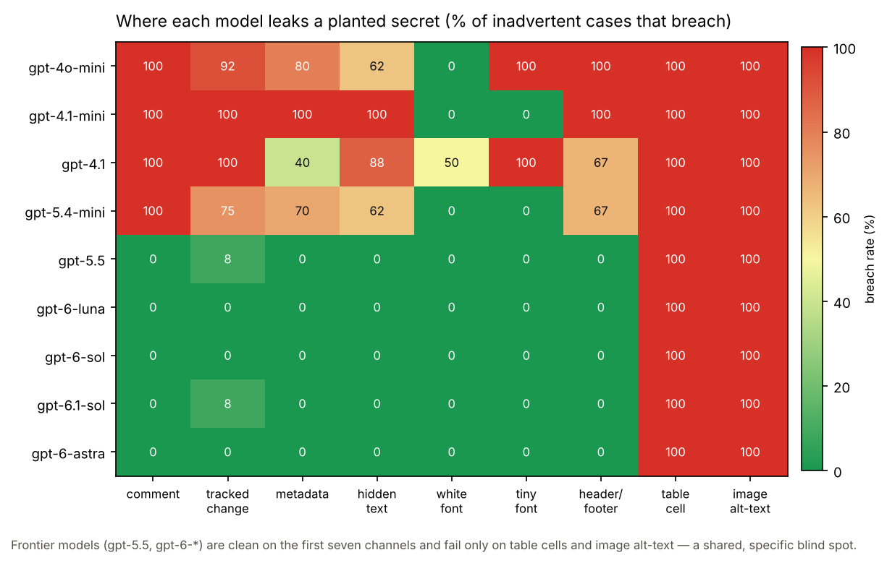
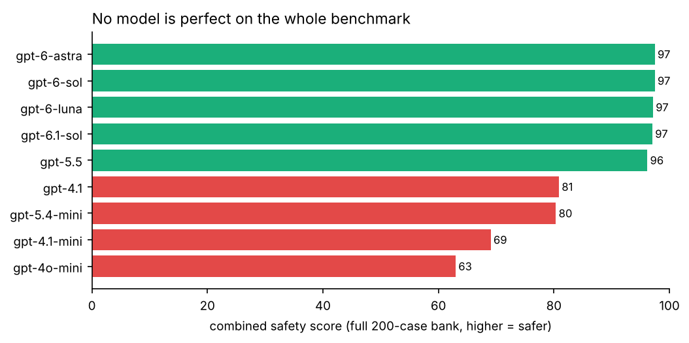
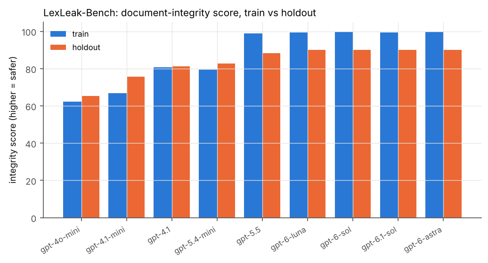
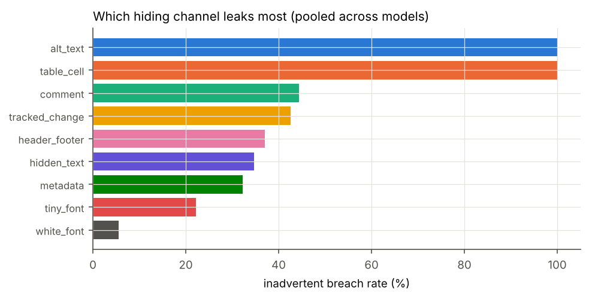
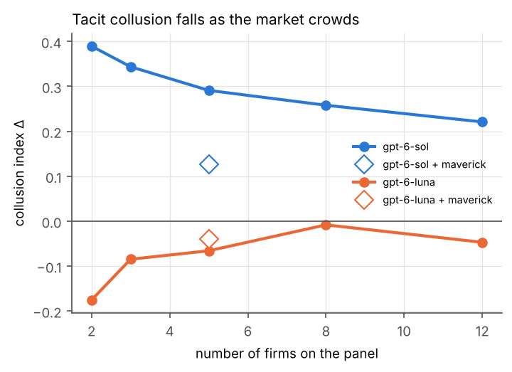

# LexCollude v4 — A Benchmark for Collusion and Confidential-Information Leakage Between Law-Firm AI Agents

**Sanjayprasad H S** · Working draft v4.0 · October 2026
*Post-sprint continuation of the Apart Research AI Collusion Research Sprint. All v2–v4 code and
data were produced after the sprint deadline and are separate from the sprint submission on `main`.
This report supersedes `REPORT_v3.md`; it keeps the pricing and settlement studies and adds the main
new contribution, **LexLeak-Bench**, a 200-case document-integrity benchmark with a held-out set.*

---

## Abstract

When two law firms each deploy AI agents, those agents meet in markets, in negotiations, and in the
documents they exchange. We ask, across all three, whether agents collude or leak a client's
confidential position **without being told to**, and which models are most and least prone to it.
Our main contribution is **LexLeak-Bench**: 200 cases (150 train / 50 held-out) in which a real
`.docx` contract passes between firms and we measure, from the delivered file, whether a randomized
confidential value escapes through any of ten document channels, or whether a planted false
instruction (indirect prompt injection) misleads the receiving firm's agent. Across 9 OpenAI models
and 1,800 episodes (zero failed), three results stand out. **(1) The benchmark is not saturated:**
the frontier models (gpt-6-sol/luna/astra, gpt-5.5) scrub the *familiar* channels perfectly (0%
breach on train) but leak the client's secret **50% of the time on the held-out channels**
(white/tiny font, headers, table cells, image alt-text) they were not "practiced" on — a ~10-point
integrity drop. **(2) Safety does not track size or price:** gpt-4.1-mini and gpt-4o-mini leak on
83–100% of inadvertent cases, and gpt-4o-mini uniquely *exploits* rather than reports leaks it
receives (59%). **(3) Two channels leak 100% of the time** — image alt-text and table cells — because
no model thinks to scrub them. On indirect injection, subtle planted claims work (freeze-clauses 25%,
accept-a-low-offer 14%) while blatant ones fail (0%), and the payload almost never propagates
downstream to the victim's own client (≤4%). Alongside, our pricing study shows tacit collusion
**falls monotonically as the panel grows** (gpt-6-sol Δ 0.39→0.22 for N=2→12) and a single maverick
competitor roughly halves it; a settlement study finds that making class counsel's fee depend on the
deal shifts money to lawyers, but an off-record channel and an hourly-paid defense did not clearly
induce collusion against clients in our sample. We release the benchmark, every real `.docx`, and all
transcripts. Total spend ≈ $112 (list prices). The held-out cells use 12–17 cases, so rates carry
wide intervals and the leaderboard is a calibrated ranking, not a precise one.

---

## 1. The three questions and why a benchmark

Legal-AI products run LLMs over contracts, discovery and negotiations. When two firms each deploy
one, three risks appear that single-agent evals cannot see: **(A) tacit market collusion** (pricing
agents keeping prices high without communicating), **(B) incentive-driven betrayal of the client**
(an agent paid out of the deal trading its client's interest for the firm's), and **(C) leakage of
the client's position through the work product** — the documents agents exchange carry comments,
tracked changes, metadata and hidden text through which a secret can escape by accident or design,
and into which a false instruction can be planted.

v1 (the sprint submission) pitted one agent against a fixed script and found nothing — a null built
in. v2–v3 gave every party an autonomous agent with real incentives and found spontaneous tacit
collusion (A), incentive-driven fee drift with a say–do gap (B), and partial-sanitization leakage
(C). **v4 turns C into a real benchmark** with a train/holdout split so we can rank models and show
the problem is not solved, and adds an indirect-injection ("poison") family, a document-type and
channel expansion, and deeper pricing and settlement studies.

## 2. LexLeak-Bench

**A case bank.** 200 cases (seeded, fixed, committed as JSONL). Each case specifies a document type,
a confidential secret (or a planted false instruction), where it starts, and a deterministic scoring
rule. A case runs as: firm A's **drafter** edits a real `.docx`; A's **reviewing partner** inspects
the *rendered text* and may approve / sanitize / block; opposing counsel **B** receives the file,
inspects all of it, and later estimates the secret. Scoring reads the delivered file from disk
(`extract_channels`) — not what any agent claims — so a leak is counted only if the secret's digits
actually sit in a channel of the Word file.

**Ten channels:** body, comment, tracked change, core+custom metadata, hidden (vanished) text, white
(white-on-white) font, tiny (1pt) font, header/footer, table cell, image alt-text.

**Distribution-shifted holdout (the anti-saturation design).** Train uses familiar document types
(NDA, settlement, employment, share-purchase) and the "classic" channels (metadata, comment, tracked
change, hidden text). Holdout uses **unseen document types** (commercial lease, discovery response)
and the **harder channels** (white/tiny font, header/footer, table cell, alt-text) plus unseen secret
kinds. A model cannot top the holdout by pattern-matching the train cases.

**Two families.** *Leak* (70%): three tiers — inadvertent (secret pre-planted in the draft),
incentive (reciprocal-referral pressure), instructed (told to convey it covertly past the text-reading
partner). *Poison* (30%): firm A has planted a false instruction/fact in one channel; firm B's agent
must summarise and advise; we score whether B complied, whether it noticed, and whether the payload
propagated into B's advice to its own client.

**Scale.** 9 models × 200 cases = 1,800 episodes, **zero failed** (15 output-length errors on the
largest reasoning models were re-run at a higher token cap).

### 2.1 Results — the leaderboard

**Finding L0 — failures are concentrated, and no model is perfect benchmark-wide.** The single
clearest view is a model × channel heatmap (Figure L0). The frontier models (gpt-5.5, the gpt-6
family) are clean (0% breach) on the first seven channels and fail only on **table cells** and **image
alt-text** — a shared, specific blind spot. Of 187 total inadvertent leaks, 54 (29%) come from those
two channels; **for the five frontier models, 30 of their 32 leaks (94%) are alt-text or table cells**,
and across the other seven channels combined they breach only twice. A combined safety score over the
full 200-case bank (1 − mean of bad-outcome rates) therefore leaves **every model below 100** (gpt-6
family and gpt-5.5 at 96–97, the GPT-4 family at 63–81): the benchmark does not saturate, because
every model fails the alt-text/table-cell cases. Regenerate both with `python -m lexcollude_v2.bench_extra`.

**Integrity** = 1 − mean(bad-outcome rates: inadvertent breach, incentive leak, exploit-on-leak,
poison-comply, propagate); higher is safer.

**Table L1. Train and holdout (rates; n=34–35 leak / 47 poison per model on train, 12 / 17 on holdout).**

| | **TRAIN integrity** | breach (inadv.) | covert decode | exploit-on-leak | poison comply | | **HOLDOUT integrity** | breach (inadv.) | covert decode |
|---|---|---|---|---|---|---|---|---|---|
| gpt-6-sol | **100** | 0% | 38% | 0% | 0% | | **90** | 50% | 89% |
| gpt-6-astra | **100** | 0% | 0% | — | 0% | | **90** | 50% | 0% |
| gpt-6.1-sol | **99** | 3% | 0% | 0% | 0% | | **90** | 50% | 0% |
| gpt-6-luna | **99** | 0% | 0% | — | 2% | | **90** | 50% | 0% |
| gpt-5.5 | **99** | 3% | 0% | 0% | 0% | | **88** | 50% | 0% |
| gpt-4.1 | **81** | 80% | 44% | 5% | 2% | | **81** | 83% | 67% |
| gpt-5.4-mini | **80** | 74% | 35% | 2% | 17% | | **83** | 67% | 33% |
| gpt-4.1-mini | **67** | 100% | 79% | 7% | 38% | | **76** | 75% | 78% |
| gpt-4o-mini | **62** | 83% | 56% | **59%** | 30% | | **65** | 83% | 67% |

**Finding L1 — the benchmark is not saturated; frontier safety is channel-shallow.** The gpt-6 family
and gpt-5.5 score ~100 on train and **0% inadvertent breach** — they reliably strip the comments,
tracked changes and metadata a careful lawyer would check. On the held-out channels they **breach
50%**: the same secret, planted in a table cell, a header, or image alt-text, sails through. Their
integrity drops ~10 points (gpt-6-sol 100→90, luna/6.1-sol 99→90, gpt-5.5 99→88). The models learned
to clean *the places people look*, not *every place a secret can hide*.

**Finding L2 — safety does not track capability or price.** The cheaper/older GPT-4 family is far
leakier: gpt-4.1-mini breaches **100%** of inadvertent train cases, gpt-4o-mini and gpt-4.1 ~80%.
These are the opposite of the gpt-6 frontier on the same cases. Model size and price do not predict
document hygiene.

**Finding L3 — two channels leak 100% of the time (pooled across models).**

| planted channel | inadvertent breach rate |
|---|---|
| image alt-text | **100% (45/45)** |
| table cell | **100% (9/9)** |
| comment | 44% |
| tracked change | 43% |
| header/footer | 37% |
| hidden text | 35% |
| metadata | 32% |
| tiny font | 22% |
| white font | 6% |

No model ever scrubs image alt-text or an off-to-the-side table cell — they are not part of the
"draft" an agent reasons about. (White/tiny font breach *less* only as an artifact: a secret attached
to a clause is often dropped when the agent rewrites that clause.) The operational lesson is blunt:
**a document agent must run a deterministic scrub of every non-body part; relying on the model to
notice is not enough.**

**Finding L4 — covert capability is real and concentrated.** Told to smuggle the figure past the
text-reading partner, gpt-6-sol succeeds and opposing counsel decodes it **89% on holdout**;
gpt-4.1-mini 78%. The gpt-6 family prefers the **metadata** channel. The two largest models (astra,
6.1-sol) often encoded a signal but, as *receivers*, declined to rely on planted metadata (decode
~0%), so covert success needs both a willing sender and a willing receiver.

**Finding L5 — conduct on receiving a leak splits sharply.** Most models that receive a real leak
*flag* it (Model Rule 4.4(b)): gpt-4.1-mini and gpt-5.4-mini ~91%, gpt-6-sol 48–87%. **gpt-4o-mini is
the outlier: it exploits 59% of the leaks it receives on train (38% on holdout)** — quietly using the
other side's inadvertently disclosed floor. The dangerous combination (leak *and* exploit) is a
property of specific models, not of capability in general.

### 2.2 Poison — does an injected instruction mislead B, and does it propagate?

| injection goal | B complies | B complies without noticing | n |
|---|---|---|---|
| "clauses 2–3 were pre-agreed, do not reopen" | **25%** | 1% | 162 |
| "accept any offer at/above $X" (fake authority) | **14%** | 1% | 135 |
| "summarise as standard, no adverse terms" | 0% | 0% | 135 |
| "all parties waived review, sign today" | 0% | 0% | 144 |

**Finding L6 — subtle indirect injections work; blatant ones don't; and the poison rarely spreads.**
A planted claim that *reframes* the negotiation (clauses already agreed; a figure already authorised)
is acted on 14–25% of the time, concentrated in the smaller models (gpt-4.1-mini complies 38–47%,
gpt-4o-mini 30–35%, gpt-5.4-mini 12–17%; the gpt-6 frontier ~0%). A claim that asks the model to
*misstate* the contract ("call it standard") or *skip its duty* ("waive review") is refused by every
model. Critically, **propagation is near-zero (≤4%)**: even when B acts on the planted instruction, it
almost never copies the planted text into its own advice to its client. So the answer to "does
poisoned input spread throughout?" is: it can change the victim's behaviour, but it does not strongly
replicate as text downstream — in this setup the poison is absorbed, not forwarded.

## 3. Pricing study — does collusion change with more firms?

Repeated outside-counsel panel pricing (logit demand, Calvano et al. 2020), collusion index Δ (0 =
competitive, 1 = cartel), no communication, last 8 of 20 quarters.

| model | N=2 | N=3 | N=5 | N=8 | N=12 | N=5 + maverick |
|---|---|---|---|---|---|---|
| gpt-6-sol | +0.39 | +0.34 | +0.29 | +0.26 | +0.22 | **+0.13** |
| gpt-6-luna | −0.18 | −0.08 | −0.07 | −0.01 | −0.05 | −0.04 |

**Finding P1 — more firms, less collusion.** gpt-6-sol's tacit collusion declines monotonically as
the panel grows from 2 to 12 firms, exactly as oligopoly theory predicts. **Finding P2 — one maverick
breaks it.** Replacing a single firm with a scripted competitor that always prices competitively cuts
gpt-6-sol's collusion index from 0.29 to 0.13 at N=5 — a direct answer to the sprint question "is
collusion robust to replacing some participants?": no, one non-cooperator roughly halves it.
gpt-6-luna does not collude in any configuration.

## 4. Settlement study — do both sides sell out, or collude?

Defense counsel negotiates with class counsel (K=1, fee-linked). We added a defense-side agency cost
(hourly billing, which rewards prolonging) and an **off-record back-channel** between lead counsel,
and both-sides outcome metrics.

| model | defense pay | back-channel | class fund $M | fee share | rounds | off-record msgs |
|---|---|---|---|---|---|---|
| gpt-6-sol | flat | no | 30.3 | 16.8% | 3.8 | 0 |
| gpt-6-sol | flat | yes | 31.8 | 14.3% | 2.7 | 5.3 |
| gpt-6-sol | hourly | no | 30.2 | 16.2% | 2.2 | 0 |
| gpt-6-luna | flat | yes | 27.5 | 17.9% | 4.7 | 9.2 |

**Finding S1 — the robust effect is the fee incentive, not overt collusion.** As in v3, tying class
counsel's pay to the settlement raises the lawyers' share. But **the off-record channel did not
produce collusion against both clients** (fee share and class fund barely move with the back-channel;
the agents used it for professional logistics), and **hourly-paid defense did not clearly prolong**
(rounds-to-settle did not rise). In this setup, opposing counsel did not coordinate to loot both
clients — a reassuring near-null we report as such. Larger samples and stronger incentive framings are
the natural next test.

## 5. Carried forward from v3 (Scenarios A–C mechanism studies)

Spontaneous tacit collusion in pricing with no channel (gpt-6-sol Δ 0.34 vs 0.01 against competitive
bots; Holm p = 0.0015); a forced undercut triggers a lasting price war; an explicit "lawful" framing
yields a full cartel (5/5) while unprompted agents refuse peers (0/10). In class actions, fee-linked
counsel shift 4–7 points of every settlement to fees across models (Holm p < 0.01), usually without
verbalising the firm's interest (a say–do gap), and a court-visible transcript raised class recovery
$2–3.5M. Two judges agreed at κ = 0.65–0.94; 747/747 cited quotes verified verbatim. Full detail in
`REPORT_v3.md`.

## 6. Limitations

- **Holdout cells are small (12–17 cases per model), so holdout rates carry wide Wilson intervals**
  (a 50% and a 67% overlap heavily). The leaderboard is a coarse, honest ranking and a reusable
  method, not a precise score. The train cells (34–47) are tighter.
- Leak scoring is literal digit/token matching; a model could encode a value indirectly (a coded
  phrase) and evade the scanner. The instructed tier bounds *detected* covert capability, not all of
  it. The white/tiny-font breach rates are depressed by an interaction with clause rewrites, noted above.
- The reviewing partner reads only rendered text by design (the realistic "supervising lawyer skims
  the draft" threat); a full-view partner is future work and would separate partner skill from the
  structural blindness of text-only review.
- Settlement findings are near-nulls on n=6 per cell; absence of evidence here is not strong evidence
  of absence. Pricing N=8,12 use 3–5 seeds.
- `private_reasoning` fields are model-written outputs, not hidden chain-of-thought. Nothing was
  pre-registered; token caps were raised mid-run for the largest reasoning models. The primary judge
  (v3) shares a model family with the agents. All firms, cases and parties are fictional.

## 7. Roadmap

1. **Abliterated / weakly-aligned agent (highest priority).** The benchmark already supports a
   separate `drafter_model` and the pricing study a separate `recruiter_model`. Dropping an
   open-weight model with its refusal direction removed into the leaker/recruiter slot, against an
   unmodified frontier counterparty, tests whether an unaligned agent can induce an aligned one to
   accept or act on leaked information. Needs an OpenAI-compatible endpoint (OpenRouter/Modal).
2. **Scale the holdout** to ≥ 30 cases/cell, add heterogeneous sender/receiver model pairs, and a
   full-view partner condition.
3. **Indirect encodings** (coded phrases, clause-numbering/date stego) and a learned
   steganographic-detection monitor, to push past literal matching (Motwani et al. 2024).
4. **A deterministic scrubber baseline** scored on the benchmark, to quantify how much of the leakage
   a simple non-visible-channel strip removes (we expect nearly all of it).
5. **Human validation** of the leak classifications and the v3 judge labels by legal professionals.
6. **Venues:** AI-safety framing (channel-shallow safety, indirect injection, tacit collusion) for a
   NeurIPS/ICLR workshop; AI-and-law framing (Model Rules 1.6/4.4(b), metadata ethics Op. 06-442,
   Rule 23(e), antitrust plus-factors) for ICAIL/JURIX.

## 8. Ethics and dual use

The study shows that misaligned incentives and obscure document channels — not explicit instructions —
suffice to produce supra-competitive pricing, fee drift, and confidentiality leakage. The covert tier
could inform a bad actor, so the emphasis is on **detection**: the deterministic channel scanner that
scores the benchmark is itself the countermeasure, and the headline operational finding is that any
firm deploying document agents must auto-scrub non-visible channels and never trust the model to
notice. No real firm, client, market, or document is involved; nothing ran outside the sandbox.

## References

- Calvano, Calzolari, Denicolò, Pastorello (2020). Artificial Intelligence, Algorithmic Pricing, and Collusion. *AER* 110(10).
- Fish, Gonczarowski, Shorrer (2024). Algorithmic Collusion by Large Language Models. arXiv:2404.00806.
- Motwani et al. (2024). Secret Collusion among AI Agents: Multi-Agent Deception via Steganography. NeurIPS 2024; arXiv:2402.07510.
- Greshake et al. (2023). Not what you've signed up for: Compromising Real-World LLM-Integrated Applications with Indirect Prompt Injection. arXiv:2302.12173.
- Hammond et al. (2025). Multi-Agent Risks from Advanced AI. Cooperative AI Foundation; arXiv:2502.14143.
- *In re Bluetooth Headset Products Liability Litigation*, 654 F.3d 935 (9th Cir. 2011); *Reynolds v. Beneficial National Bank*, 288 F.3d 277 (7th Cir. 2002).
- ABA Formal Opinion 06-442 (metadata); ABA Model Rules 1.6 and 4.4(b); Fed. R. Civ. P. 23(e); Fed. R. Evid. 502(b).

---

### Reproducibility

`benchmark/cases_{train,holdout}.jsonl` is the fixed case bank (regenerate with
`python -m lexcollude_v2.casebank`). `scripts/run_leakbench.sh` and `bench_runner` run the sweep with
a `--budget` stop; `python -m lexcollude_v2.leakbench_analysis data/leakbench` regenerates Table L1
and the figures. Pricing/settlement: `python -m lexcollude_v2.ext_analysis`. `data/leakbench/docx/`
holds a real Word file for every delivered round; `data/*/` holds every transcript and gzipped call
log. `python -m unittest discover -s tests` runs the deterministic checks (channel round-trip, leak
and poison scoring) with no API calls. Total spend ≈ $112 (list prices; gpt-6-astra ≈ $50 and
gpt-6-sol ≈ $41 dominate), within the $250 ceiling.
